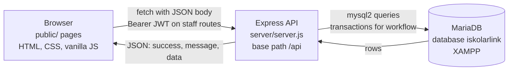
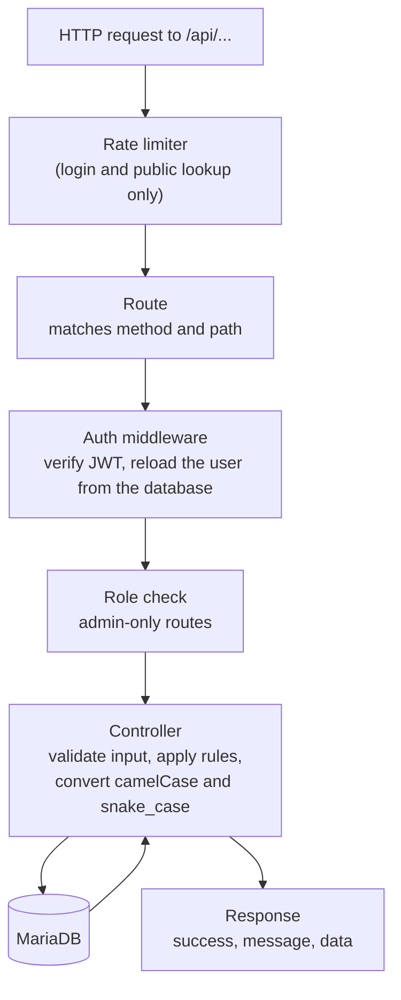

# IskolarLink Architecture

This document explains how the pieces of IskolarLink fit together: the three layers, how a request travels through the server, what each folder is for, and what each database table stores. For every endpoint see [api.md](api.md). For the full ERD and the allowed phase transitions see [erd.md](erd.md).

## 1. System overview

IskolarLink has three layers. The browser pages call a JSON API, and the API is the only thing that talks to the database.



| Layer | Technology | Responsibility |
|---|---|---|
| Browser | HTML, CSS, vanilla JavaScript | Staff screens and the public status lookup. Holds no business rules. |
| API | Node.js, Express 5 | Authentication, role checks, validation, phase rules, rate limiting. |
| Database | MariaDB (XAMPP), accessed with `mysql2` | Stores all data and enforces uniqueness and CHECK constraints. |

Supporting libraries (from `package.json`): `jsonwebtoken` for login tokens, `bcrypt` for password and PIN hashes, `express-rate-limit` for the login and public lookup limits, `helmet` for security headers, `cors` for cross-origin requests, and `dotenv` for the `.env` file.

## 2. Request flow

Every request follows the same path: routes, then middleware, then a controller, then the database.



1. **Routes** map a method and path (for example `POST /api/applications`) to a handler. A path that matches nothing returns a "Route not found" response.
2. **Auth middleware** reads the `Authorization: Bearer <token>` header and verifies the JWT. It then re-checks the account in the database on every request, so a deactivated user stops working immediately and a role change applies immediately. A missing, malformed, tampered or expired token returns 401.
3. **Role check** runs after authentication on admin-only routes (users, program and tier writes, reopening an approved application). A valid token with the wrong role returns 403.
4. **Controllers** validate the body (400), look up the records (404), apply business rules (409), and run the database work. The workflow endpoints run inside a transaction and lock the application row with `SELECT ... FOR UPDATE`, so two simultaneous changes cannot both succeed.
5. **Responses** always use the same envelope: `{ "success": true|false, "message": "...", "data": ... }`. Error responses never contain stack traces or SQL errors.

The public lookup (`POST /api/public/lookup`) skips authentication. It is protected instead by the staff-issued PIN, a per-IP rate limit and a per-reference lockout (5 failures lock a reference for 15 minutes), and it returns the same generic 404 for every failure. The dashboard (`GET /api/dashboard`) follows the normal path: login, then a controller that reads the totals.

## 3. Folder structure

```text
IskolarLink/
├── README.md              Project overview, setup, contributing, links to docs
├── package.json           Dependencies and scripts (npm start, npm run dev)
├── .env                   Local secrets (never committed)
├── .env.example           Template of the variables the server reads
├── .gitignore             Files Git must not track (.env, node_modules, desktop.ini)
├── database/              SQL files that build and seed the database
│   ├── schema.sql         Creates the database and all tables
│   ├── seed.sql           Base data: users, programs, tiers
│   └── seed_applicants.sql  Demo applicants, applications, history, grant schedules
├── docs/                  Project documentation (this folder)
│   ├── api.md             Every endpoint
│   ├── erd.md             ERD and phase transitions
│   ├── architecture.md    This file
│   ├── testing.md         Test scripts and the manual QA checklist
│   ├── troubleshooting.md Common problems and fixes
│   └── demo-data.md       Demo logins, PIN and reference numbers
├── public/                The front end served to the browser
│   ├── css/styles.css     The one stylesheet
│   ├── js/                One script per page, plus shared helpers
│   │   ├── common.js      Shared helpers (API calls, login state, top bar)
│   │   ├── confirm.js     Confirmation dialog helper
│   │   └── index.js, login.js, dashboard.js, applicants.js,
│   │       applications.js, programs.js, users.js
│   ├── logo.svg
│   └── *.html             index (public status lookup, the home page), login,
│                          dashboard, applicants, applications, programs, users
├── server/                The Express API
│   ├── server.js          Entry point (npm start runs this file)
│   ├── app.js             Builds the app: security headers, CORS, body limit, routes
│   ├── config/            Database connection and settings
│   ├── routes/            Maps each URL and method to a handler
│   ├── middleware/        Login check and role check
│   ├── controllers/       Validation, business rules and database work
│   └── utils/             Shared helpers (responses, mappers, PIN, lookup lockout)
└── tests/                 Smoke test scripts, see testing.md
```

| Folder | What it is for |
|---|---|
| `database/` | Import order matters: `schema.sql`, then `seed.sql`, then `seed_applicants.sql`. |
| `docs/` | API contract, ERD, architecture, testing notes, troubleshooting and demo data. |
| `public/` | Everything the browser loads. The home page (`index.html`) is the public status lookup, and staff pages are reached from its Staff login link. All pages talk to the API with `fetch`. |
| `server/` | All backend code. The entry point is `server/server.js`, which loads `server/app.js`. |
| `tests/` | Six smoke test scripts that call the running API. They create rows and trip rate limits, so read [testing.md](testing.md) before running them. |

## 4. Database tables

The database has seven tables. The full diagram is in [erd.md](erd.md).

| Table | What it stores | Key relationships |
|---|---|---|
| `users` | Staff and admin accounts: username, password hash, full name, role (`admin` or `staff`), and whether the account is active. | One user can appear in many `status_history` rows as the person who changed a phase. |
| `applicants` | The people applying: name, birth date, address, school details, GWA, household income, and an archived flag. | One applicant has many `applications`. A name plus birth date must be unique. |
| `scholarship_programs` | Scholarship programs: name, type (`grant` or `non_grant`), criteria, status and an archived flag. | One program receives many `applications` and defines many `program_tiers`. |
| `program_tiers` | Award tiers inside a program, each with a default amount. | Belongs to one program. An application may be assigned one tier. |
| `applications` | One application per applicant, program and academic year: reference number, current phase, eligibility, ineligibility reason, tier, documents flag, remarks and the hashed lookup PIN. | Belongs to one applicant and one program, optionally one tier. Has many `status_history` rows and at most one `grant_schedules` row. |
| `status_history` | The timeline: every phase change with the old phase, new phase, who changed it, remarks and time. | Belongs to one application and one user. |
| `grant_schedules` | When, where and how much a grant is released for an approved application. | At most one per application. Only for grant-type programs. |

How they relate in plain words: an applicant files applications; each application is for one program (and may get one tier from that program); every phase change is logged in `status_history` with the staff member who made it; and an approved application in a grant program can have one `grant_schedules` row.

The database itself enforces the duplicate checks (applicant identity, duplicate application, one schedule per application) and two CHECK constraints (an ineligible application needs a reason, and only eligible applications can have a tier). Rules that span tables, such as legal phase transitions, are enforced by the controllers. The full list is in [erd.md](erd.md).

## 5. Security design in brief

- Passwords and lookup PINs are stored only as bcrypt hashes. A lost PIN cannot be shown again; staff issue a new one.
- Login is rate limited, and every login failure returns the same message so usernames cannot be guessed.
- The public lookup needs the reference number, birth date and PIN together, returns only a small set of fields, and uses one generic 404 for every failure.
- Every database query is parameterized, so input is never treated as SQL.
- `helmet` sets security headers and a content security policy, CORS allows only the configured origin, request bodies are limited to 100 KB, and API responses are sent with `Cache-Control: no-store`.
- The pages show data with `textContent`, not `innerHTML`, so stored text is shown as text and never run as script.
- Errors return a generic 500 message. Stack traces and SQL errors never reach the client.
- Records are archived instead of deleted for applicants, programs and applications.