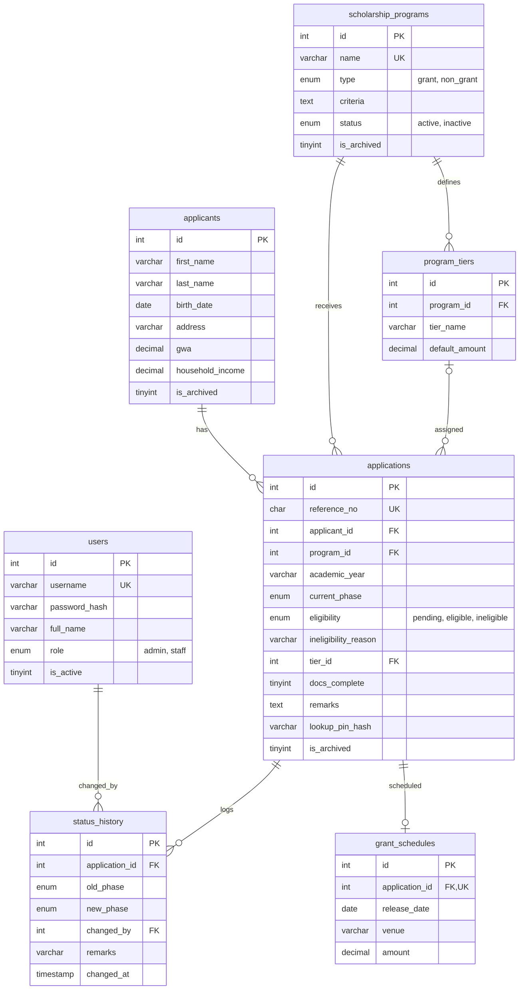

# IskolarLink ERD and Status Transitions

## ERD (Mermaid)

Note: `program_tiers` is added beyond the five tables in the proposal so tiers are a real foreign key instead of free text. The proposal says the ERD is finalized at defense, so this is fine.

## Allowed phase transitions

| From             | To                              | Extra rule                                                    |
|------------------|---------------------------------|---------------------------------------------------------------|
| (new)            | Submitted                       | Set on creation, first history row                            |
| Submitted        | Under Review                    |                                                               |
| Under Review     | For Evaluation                  | `docs_complete` must be 1                                     |
| Under Review     | Ineligible                      | Reason required (e.g. incomplete or invalid documents)        |
| For Evaluation   | Approved                        | `eligibility` = eligible and a tier assigned                  |
| For Evaluation   | Ineligible                      | Reason required                                               |
| Approved         | Granted                         | Grant-type program must have a grant schedule                 |
| Approved         | For Evaluation                  | **Reopen.** Admin only. Reason required and saved in history. Eligibility and tier are kept; the application must be approved again |
| Ineligible       | (none)                          | Terminal                                                      |
| Granted          | (none)                          | Terminal                                                      |

Every transition updates `applications` and inserts into `status_history` in one transaction. The application row is locked (`SELECT ... FOR UPDATE`) for the duration, so simultaneous changes are processed one at a time. Marking an application Ineligible also sets `eligibility = 'ineligible'`, saves the reason and clears the tier in the same transaction.

## Rules the database enforces vs. the backend

| Rule                                          | Enforced by                      |
|-----------------------------------------------|----------------------------------|
| Duplicate application (applicant + program + year) | UNIQUE `uq_application_dup`  |
| Duplicate applicant (name + birth date)       | UNIQUE `uq_applicant_identity`   |
| Ineligible requires reason                    | CHECK `chk_reason_required` (and backend) |
| Tier only on eligible applicants              | CHECK `chk_tier_only_eligible` (and backend) |
| One grant schedule per application            | UNIQUE `uq_schedule_application` |
| Grant schedule only for grant-type programs   | Backend (spans tables)           |
| Grant schedule only while the application is Approved | Backend                  |
| Tier belongs to the application's program     | Backend (spans tables)           |
| Tier changes only while For Evaluation        | Backend                          |
| Legal phase transitions                       | Backend (table above)            |
| Reopen is admin-only and needs a reason       | Backend (role check + validation) |
| Phase and eligibility stay in sync on Ineligible | Backend (one transaction), backed by the CHECK constraints |
| Simultaneous changes to one application       | Backend (row lock inside the transaction) |